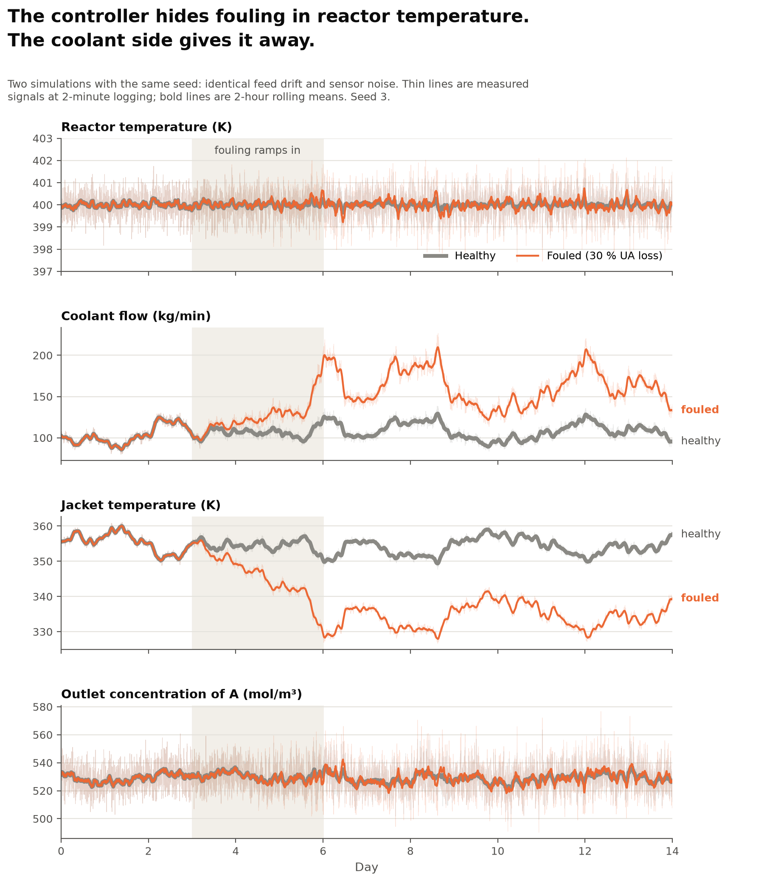

# Week 4 — dataset and splits

Started: November 3 2026

## What I built
Generate data from the model using the following parameters:

    n_train: int = 20                                              #normal runs
    n_val: int = 20                                                #validation runs
    n_test_normal: int = 50                                        #normal test runs
    n_test_faulted: int = 50                                       #faulted test runs
    base_seed: int = 0                                             #offset += base_seed
    sim_time: float = 1440*14                                      #minutes
    dt: float = 0.05                                               #minutes
    is_faulted: bool = False
    fault_type: str = "none"
    fouling_range: Tuple[float, float] = (0.10, 0.50)               # 10% to 50% loss in UA
    pump_trip_range: Tuple[float, float] = (0.10, 0.70)             # 10% to 70% flow reduction
    sensor_bias_temp_range: Tuple[float, float] = (0.5, 5.0)        # +/- 0.5 K to +5 K measurement bias
    fault_start_window: Tuple[float, float] = (4320.0, 10080.0)     # Start between 3-7 days (minutes)


## What broke, and what fixed it
generate data took a while trying to get faults and drift correctly injected using 
random start times and random severities. tested generate on single runs and double runs. debugged a lot of code relating to faults and how to display the final table. Had trouble passing the seed through the whole model (every run has its own seed and therefore a unique run ID). Had problems with python syntax trying to print pd tables and merge them correctly. Still not completely clear on this but I do not have time to learn python syntax for it now.

1. docs said day 2, code did day 3. Cause: a comment wasn’t updated when the constant changed. Caught by Claude when checking the code against the docs.
2. Two machines gave different runs.csv hashes. Cause: full-precision floats pick up last-bit differences between platforms. Fix: float_format.
3. The saturation limits (39.7 %, 50 %) assumed nominal disturbances. Drift moves saturation down to about 30 % fouling and about 40 % pump loss. Measured from qc_cmd.
4. T variance rose under fouling. The hypothesis was bad tuning. The cause was a 55 % gain loss, confirmed by the step test to 0.07 %.

<!-- The most valuable section. Every bug you diagnose is a story you can
     tell in an interview. Root cause, not just symptom. -->

## What I did not understand at first
lots of python syntax regarding ploting, printing, tables and data inspection/generation

## Decisions I made, and why
240 total runs: 14 days plus a 2 h warm-up(discarded, needed for drift), drift on, fault start randomly drawn between day 3 and day 7, data logged every 2 minutes to 4 decimal places, with measured data and truth channels in separate files. Fouling: 10-50% UA loss, 3-day ramp.
Pump loss: 10-70% flow loss, step. RTD bias: 0.5-5K, random sign, step. All faults randomly start between day 3 to day 7. All faults last to day 14. 
Thought about retuning the controller with a 3 % step, the results would have been a 1.5%-2.8% difference, so i left it. The response is nonlinear because 400 K sits close to the extinction fold (Week 3 finding that a 1.04 K feed drop kills the ignited state with the valve frozen).
The gain increase by using a +-1% step  wasnt worth changing the controller settings 

Healthy plant, step	          Kp, K per kg/min
+3 %	                              −0.5489
−3 %                              	−0.4818
+1 %	                              −0.5205
−1 %	                              −0.4989
+0.3 %	                         −0.5123
	
                    +1 %	         −1 %	     Central difference
Healthy Kp	     −0.5205	   −0.4989	          0.5097
Fouled Kp	          −0.2340	   −0.2289	          0.2315
Fouled ÷ healthy	0.450	   0.459	               0.4541
Closed form UA²/(UA + qc·Cpc)²			          0.4544

## Fouling
30% or less fouling severity never hit max coolant flow limit for a total of 22 runs.
30%-35% fouling severity hit max coolant flow limit 4-12% of the time for a total or 3 runs.
35%-39.5% fouling severity hit max coolant flow limit 20-65% of the time for a total of 7 runs
39.7% and above fouling severity hit max coolant flow limit 57-100% of the time for a total of 18 runs
Total of 28 out of 50 fouling runs hit the max coolant flow rate

## Pump Trip
Valve saturation starts at 40% pump loss. 26 runs spend more than 1% of the time saturated. 33 out of 50 runs touch the limit at some point.

## Sensor Bias
None of the runs hit saturation
```
#TEST - START
run_id,    time,       fault_kind,   severity,      onset       
98,         9292,       fouling,     0.3166,     9291.9106,
T,             Tc,         Ca,         qc,         qc_cmd,            
399.9926,   353.3900,   529.1633,  111.0864,       113.9476,    
T0,             Tc_in,              Ca0
301.2967,        293.0029,           2479.8100
```
```
#TEST - END
run_id,    time,       fault_kind,   severity,       onset       
98,         20160,       fouling,     0.3166,      9291.9106,
T,             Tc,         Ca,         qc,           qc_cmd,            
399.5487,   329.3996,   536.5154,    182.8588,       184.3933,    
T0,             Tc_in,              Ca0
301.1564,        293.1048,           2509.3330,
```
```
#TRUTH - START
run_id,    time,        fault_kind,   severity,      onset       
98,        9292,           fouling,     0.3166,     9291.9106,
T_true,             Tc_true,         Ca_true,        Ca0_true,             
400.1267,            352.8575,       525.4887,    2492.5779,          
T0_true,           Tc,in_true,         UA_true,
300.7063,           293.2781,         599996.0688
```
```
#TRUTH - END
run_id,     time,       T_true,         Tc_true,        Ca_true,       
98,         20160,    399.1634,       329.6993,       539.2157,      
Ca0_true,       T0_true,        Tc_in_true,     UA_true
2489.1446,      301.0404,       292.8080,       410049.3071
```
The variance rise is the plant losing gain, not a controller defect.
Plants keep fixed tuning between turnarounds. “Loop got sluggish” is exactly
what control-performance monitoring is built to catch, using the Harris minimum-variance index. A rolling std of T is therefore a legitimate detector feature.


<!-- Every arbitrary-looking choice needs its reason recorded NOW, while
     you still have it. "Why 400 K?" is only answerable in week 6 if you
     wrote it down in week 3. -->

## Interview gate — answered out loud, no notes

- [ ] Why three splits and not two?
     You need to train on one split, validate on a different split and test on a third split, all with different seeds.
     training, testing and/or validating on the same data set leads to circularity and optimistically biased results. Training: fits the model (no thresholds, no detection). Validation: sets thresholds for FAR (no weights or faults). Test(normal): Measure false alarm rates. Test(faulted): true detection and missed detection rates. 
     Setting thresholds on training runs makes them too tight because the model scroes its own training data as more normal than new data. Training fits the model, validation sets the thresholds and test is used once at the end to report results.

- [ ] Your dataset is simulated. What does that mean your results do and
      do not demonstrate?
      Results show that the detector works and can be compared to a detector running the same model physics, noise, drift and faults. Simulated comparison carry over better than absolute detection rates do
      Real plants never give "normal" training data and there will be a mismatch between the model and actual plant operations, including disturbances that were not modeled, drift that differs from the OU model, proper calibration, changes in operating data, lack of guaranteed-normal training data, labeled fault onsets and missing or frozen data.

## Split design
Split     |     Runs	|     Contents	    |      Seeds |
==========================================================
Train	|     20	     | Normal	         |      0–19
Validation|	 20	     | Normal	         |      20-39
Test	     |     200	     | 50 normal;       |      40-89
                         | 50 fouling,      |      90-139    
                         | 50 pump loss,    |      140-189
                         | 50 RTD bias	    |      190-239

Fault	|    Severity	|     Shape        |   Type     |
==========================================================
Fouling	|     10–50%   |      UA loss	    |     3-day ramp
Pump loss	|     10–70%   |      flow loss   |     Step
RTD bias	|     0.5–5 K  |      random sign |     Step


## The money plot



For a 30% UA loss, the reactor temperature moved by 0.03K but raised the coolant
flow rate by 48% and dropped the jacket temperature by 20 K. A rise in Feed temperature, however, is also coupled with coolant flow rate and jacket temperature.
            |Fault start    |  Fault End     |
coolant flow|111.0864 kg/min| 182.8588 kg/min|
Coolant Temp|353.3900 K     | 329.3996 K     |
Reactor Temp|399.9926 K     | 400.1267 K     |


<!-- Once healthy vs fouling is plotted: does reactor temperature really
     look identical? By how much does coolant flow diverge? This figure
     opens your README, so describe what it shows in one sentence. -->

## Time spent

|Day |Nov|Hours| On what |
|----|---|-----|---------|
| Mon| 2 |     |
| Tue| 3 | 4   | setup, parameters        
| Wed| 4 | 4   |
| Thu| 5 | 4   |
| Fri| 6 | 4   |money plot
| Sat| 7 | 4   |money plot
| Sun| 8 | 4   |general cleanup
